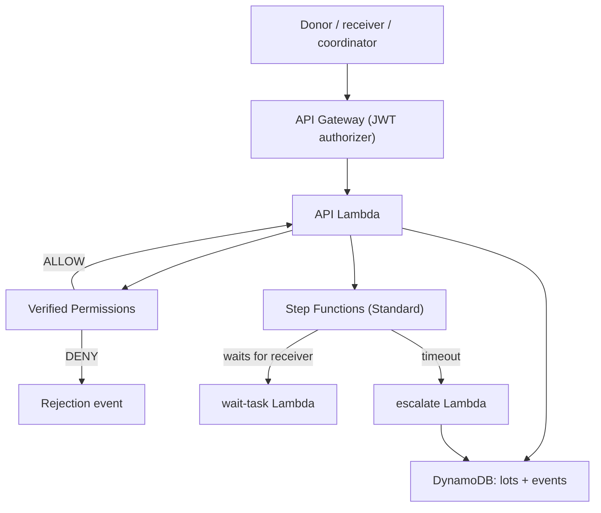

# PantryPass

A surplus-food handoff tracker where a donor cannot declare a lot "distributed". Only the assigned receiver can report what arrived and what happened to it, unanswered pickups become visible exceptions, and AWS enforces every transition.

Built for Environmental Hacks (Waste and Energy track).

> **Status:** the backend is built and tested on AWS. The web UI, hosting, and demo video are in progress.

## The idea in one scenario

Meera coordinates surplus food for a small Bengaluru group (a demo persona). A donor says ten packets are on their way, but nobody has confirmed they arrived. In most tools, the donor taps "done" and the count is wrong from then on. Here, the donor's attempt is refused by the backend, and only the assigned receiver's reports move the numbers. See [`docs/idea.md`](docs/idea.md).

## What works today

- Create a lot, then accept, declare handoff, report receipt, report distribution, and close, each by the right role only.
- A Step Functions Standard execution waits for the receiver and times out into an exception.
- Verified Permissions decides every action; a denied request returns who tried what.
- DynamoDB conditional writes: duplicate requests do not double-count, stale versions are rejected, concurrent requests produce exactly one winner.
- Quantity invariant: `received = distributed + returned + disposed + remaining`.
- Late actions are blocked using server time.
- A failed workflow callback leaves the lot non-final until a retry reconciles it.

## Architecture



Region: ap-south-1.

## Repository layout

| Path | Contents |
|---|---|
| `backend/` | Lambda handlers, Cedar policies and schema |
| `infra/` | AWS CLI scripts that create the stack (idempotent) |
| `tests/run_gates.sh` | End-to-end checks against the deployed stack |
| `docs/idea.md` | Problem, scope and what the project does not claim |

## Running the tests

Requires the AWS CLI configured for the target account and the stack deployed (`infra/` scripts in numeric order, then `infra/.env.generated` is created):

```bash
source infra/00_env.sh
bash tests/run_gates.sh
```

The script creates its own throwaway test passwords in memory and prints PASS/FAIL per check. Last run: 52 checks, 0 failures.

## What this does not claim

PantryPass records who reported what. It does not prove food was eaten or safe, and it does not measure avoided waste. Two parties who agree on a false number would still pass. All lots in the current demo are synthetic. Next step: one real operator and one real lot.

## AI tools used

Parts of the backend, infrastructure scripts and tests were written with AI coding assistance (Claude and DeepSeek), then reviewed and tested by the team.