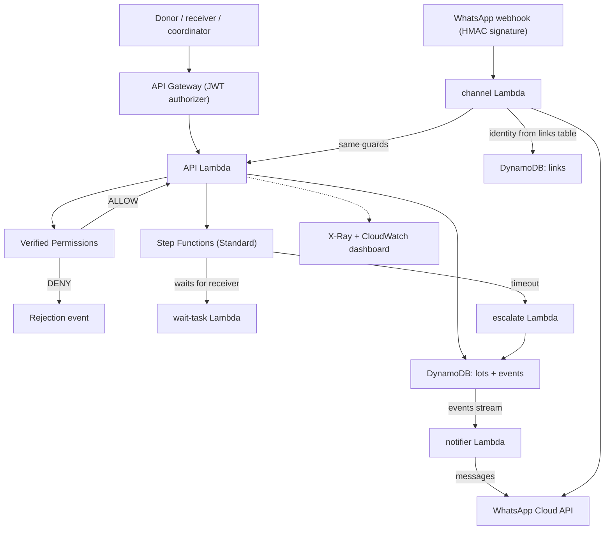

# PantryPass

A surplus-food handoff tracker where a donor cannot declare a lot "distributed". Only the assigned receiver can report what arrived and what happened to it, unanswered pickups become visible exceptions, and AWS enforces every transition.

Built for Environmental Hacks (Waste and Energy track).

> **Status:** the backend, web UI, hosting, trust record (pickup code and hash-chained events) and chat adapter are built and deployed to AWS. The chat adapter is tested against signed test payloads; a live WhatsApp round trip needs Meta credentials and is not claimed here. The demo video is in progress.

## The idea in one scenario

Meera coordinates surplus food for a small Bengaluru group (a demo persona). A donor says ten packets are on their way, but nobody has confirmed they arrived. In most tools, the donor taps "done" and the count is wrong from then on. Here, the donor's attempt is refused by the backend, and only the assigned receiver's reports move the numbers. See [`docs/idea.md`](docs/idea.md).

## What works today

- Create a lot, then accept, declare handoff, report receipt, report distribution, and close, each by the right role only.
- A Step Functions Standard execution waits for the receiver and times out into an exception.
- Verified Permissions decides every action; a denied request returns who tried what.
- DynamoDB conditional writes: duplicate requests do not double-count, stale versions are rejected, concurrent requests produce exactly one winner.
- Quantity invariant: `received = distributed + returned + disposed + remaining`.
- Late actions are blocked using server time.
- A failed workflow callback leaves the lot non-final until a retry reconciles it.
- **Pickup code:** the handoff gives the donor a one-time 6-digit code (only a salted hash is stored). A receiver who types it at receipt marks the lot "confirmed in person". Wrong codes are limited to 5 attempts and codes expire; a receipt without a code still works and is not marked in person.
- **Tamper-evident record:** every state-changing event is hash-chained (`hash = sha256(prev_hash + the event's stored fields)`) and the lot carries the chain head, updated in the same conditional write. `GET /lots/{id}/verify` recomputes the chain and the UI shows "Record verified". This detects edited, removed or reordered events; it does not stop someone who can rewrite both the events table and the lot's chain head.
- **Chat channel (WhatsApp Cloud API):** `ACCEPT`, `HANDOFF n`, `RECEIVED n [CODE 123456]`, `DISTRIBUTED n`, `RETURNED n`, `DISPOSED n`, `CLOSE`, `STATUS`. Webhook requests must carry a valid `X-Hub-Signature-256`; the sender is mapped to a Cognito user and role only through the `pantrypass-links` table; the command then goes through the same API and the same Verified Permissions check, so a donor texting `DISTRIBUTED 5` is refused exactly as on the web. The WhatsApp message id is the idempotency key. A DynamoDB Stream notifier messages the receiver (offers, handoffs), the coordinator (exceptions, count disputes) and the donor (close).
- **Impact (coordinator):** `GET /impact` counts packets offered, received, distributed, returned, disposed, lots accounted for, disputes caught, exceptions raised and lots confirmed in person, as reported by the people involved. These are not meals, kilograms or avoided waste.
- **Observability:** X-Ray on the Lambdas and the state machine, log metric filters (denies, exceptions, callback failures, chat commands, bad signatures), a CloudWatch dashboard named `PantryPass`, and API stage throttling.

## Architecture



Cost and Well-Architected notes: everything is serverless and pay-per-use (API Gateway, Lambda, DynamoDB on-demand, Step Functions Standard, Verified Permissions, S3 + CloudFront, Secrets Manager for one secret). Operational excellence: structured logs, metric filters, dashboard, tracing. Security: JWT authorizer, per-request policy decision, signed webhooks, secrets only in Secrets Manager, least-privilege role for the channel. Reliability: conditional writes, idempotency keys, durable workflow wait. Cost: stage throttling caps a runaway client. Not done: multi-region, WAF, anchoring the chain head outside the database.

Region: ap-south-1.

## Repository layout

| Path | Contents |
|---|---|
| `backend/` | Lambda handlers (`api.py`, Go routes in `go/`, `channel.py`, `notifier.py`, `escalate.py`), pure helpers (`trust.py`, `chatlogic.py`), Cedar policies and schema |
| `web/` | Static UI: plain HTML, CSS and ES modules, no build step |
| `infra/` | AWS CLI scripts that create the stack (idempotent); `70_hosting.sh` deploys the site, `99_cleanup.sh` removes everything |
| `tests/run_gates.sh` | End-to-end checks against the deployed stack |
| `docs/idea.md` | Problem, scope and what the project does not claim |
| `docs/demo-script.md` | Shot list and narration for the demo video |
| `tests/test_*.py` | Python unit tests (`python3 -m unittest discover -s tests -p 'test_*.py'`) for the hash chain, pickup code, API handlers and chat adapter |
| `tests/live_trust.py` | Live check against the deployed stack: pickup code, chain verify, tamper detection, impact, signed webhook |
| `tests/logic.test.mjs` | Unit tests for the UI rules (`node --test tests/logic.test.mjs`) |
| `tests/ui_checklist.md` | Manual QA and role-rehearsal checklist |

## Running the tests

Requires the AWS CLI configured for the target account and the stack deployed (`infra/` scripts in numeric order, then `infra/.env.generated` is created):

```bash
source infra/00_env.sh
bash tests/run_gates.sh
```

The script creates its own throwaway test passwords in memory and prints PASS/FAIL per check. Last run: all of gates 2 to 5 pass. `python3 tests/live_trust.py` adds the trust-record and webhook checks (all pass), and the offline suites are `python3 -m unittest discover -s tests -p 'test_*.py'` (105 tests), `node --test tests/logic.test.mjs` (87 tests) and `go test ./...` in `backend/go`.

## Running the UI

Without any AWS access, in demo mode against an in-memory fake of the API:

```bash
cd web && python3 -m http.server 8099
# open http://localhost:8099/?mock=1  (add &as=donor, &as=receiver or &as=coordinator to skip sign-in)
```

Against the deployed stack: run `infra/20_cognito.sh`, `infra/25_demo_passwords.sh` (with `DEMO_PASSWORD` set; the password is never stored), `infra/60_api.sh`, then `infra/70_hosting.sh`, which prints the CloudFront URL. Demo credentials are shared in the submission notes, not in this repository.

## What this does not claim

PantryPass records who reported what. A pickup code shows two people were together at handoff, not that the count is true. It does not prove food was eaten or safe, and it does not measure avoided waste. Two parties who agree on a false number would still pass. All lots in the current demo are synthetic. Next step: one real operator and one real lot.

## AI tools used

Parts of the backend, infrastructure scripts, tests and UI were written with AI coding assistance (Claude and DeepSeek), then reviewed and tested by the team. The demo narration is synthetic text-to-speech.