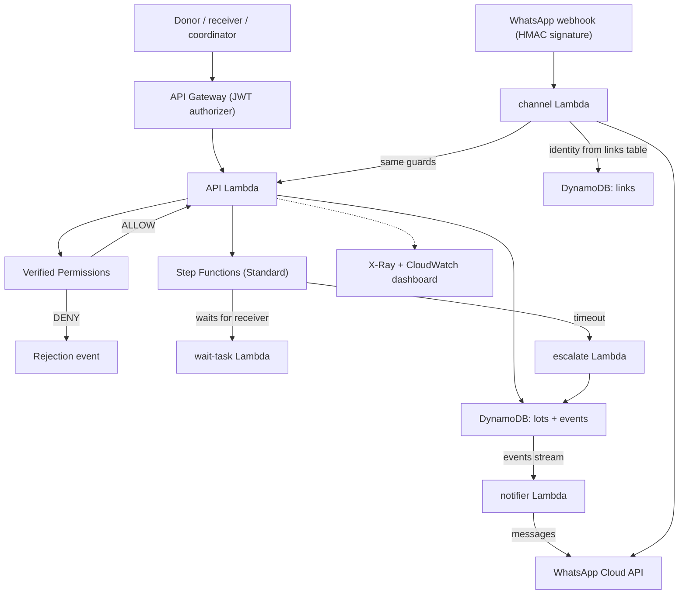

# PantryPass

**A shared record of surplus-food handoffs where the count stays right.**

Built for Environmental Hacks (Waste and Energy track).

> **Status:** the backend, web UI, hosting, trust record (pickup code and hash-chained events) and chat adapter are built and deployed to AWS. The chat adapter is tested against signed test payloads; a live WhatsApp round trip needs Meta credentials and is not claimed here.

## The problem

Surplus food usually moves by trust and WhatsApp messages. A donor says ten trays of food are on the way, someone taps "done", and the spreadsheet says ten distributed. Afterwards nobody can say how much actually arrived, where they went, or what was thrown away. Three different facts (offered, handed over, received and distributed) get blurred into one number, and whoever updated last wins. See [`docs/idea.md`](docs/idea.md).

## What PantryPass guarantees

**The count can't be wrong because the person who benefits from saying "done" isn't allowed to say it.** Each person reports only their own part, and anything unconfirmed stays visibly open. Meera, a coordinator (a demo persona), can see what is confirmed, what is disputed and what nobody answered, and the numbers stay right.

What makes that hold, beyond a single role check:

- **The rule is enforced by AWS, not by the app.** Every action is decided by Verified Permissions (Cedar policies) *before any data is touched*. The role comes from the signed Cognito token, never from anything the client sends. A refused attempt (for example a donor trying to report distribution) is also written as a DENY event, so the audit trail shows it. This is the visible 10-second proof; the rest is what keeps the count trustworthy.
- **Two people can't change a lot at once, and a retry never double-counts.** DynamoDB conditional writes plus idempotency keys.
- **The numbers always add up.** `received = distributed + returned + disposed + remaining` is enforced on every write; late actions are blocked on server time.
- **Nobody has to remember to chase.** An unanswered pickup becomes an exception through a durable Step Functions wait.
- **The handoff happened in person, and history wasn't edited.** A one-time pickup code confirms the handoff; every event is hash-chained and the UI shows "Record verified".
- **It meets people where they are.** A WhatsApp channel runs through the same guards (see below).

## Also works today

- Create a lot, then accept, declare handoff, report receipt, report distribution, and close, each by the right role only.
- A failed workflow callback leaves the lot non-final until a retry reconciles it.
- **Pickup code:** the handoff gives the donor a one-time 6-digit code (only a salted hash is stored). A receiver who types it at receipt marks the lot "confirmed in person". Wrong codes are limited to 5 attempts and codes expire; a receipt without a code still works and is not marked in person.
- **Announced to everyone, claimed by one:** a donor does not pick a receiver. A new lot is an **open offer** that every receiver can see under *Open offers*; the first receiver to claim it wins and then collects it in person. The claim is one Verified Permissions decision (Cedar rule `06_open_offer.cedar`: any receiver may claim a lot whose receiver is still `unclaimed`), committed in one conditional DynamoDB transaction, so two receivers cannot both win. Nobody claims it before the response deadline: the durable Step Functions wait raises an exception for the coordinator.
- **Any food, any unit:** a lot has a food name and a unit (kg, litres, plates, packets, boxes, trays, pieces). Quantities are whole numbers of that unit, and the impact report never adds different units together.
- **Donor incentive fund (the business model):** sponsors (company CSR budgets, local businesses) and community donors top up a monthly pool; the pool is shared among food donors in proportion to their **trust points**, with a per-donor cap (30%). Points come from verified, receiver-confirmed handoffs. The amount counts only once verified: the receiver's confirmed count adds a bonus that grows with the log of the quantity, is capped per lot and shrinks for repeat handoffs between the same two people, so a bigger lot is worth more but inflating one is not. A lot whose record fails `Verify` earns nothing. Only donors with at least 3 verified lots to at least 2 different receivers (*top donors*) share the pool and are listed publicly. Sponsors get what CSR teams need: a tamper-evident record of what was really received and distributed. `GET /fund` and the *Fund* page show this; **in this demo the pool is a configured number, a few clearly labelled simulated peer donors join it so the sharing is visible, and no money moves.**
- **Payout details and automatic payouts:** a donor adds bank details (name, account number, IFSC, optional UPI). The account number is encrypted with KMS before it is stored and is only ever shown masked. Payouts are sent automatically through RazorpayX (one click from the coordinator with `POST /payouts/run`, or an EventBridge schedule). The server reads the account number from KMS and sends it to Razorpay itself, so the volunteer coordinator, Meera, never sees an account number. Each payout is idempotent and ordinal, and its status follows Razorpay's webhooks. See `docs/api.md` ("Payouts") and `infra/90_payouts.sh`.
- **Direct donations and the pool:** any signed-in user can donate to a top donor (not to themselves), and anyone can add to the monthly pool, through Razorpay Checkout. Payments pass through Razorpay: PantryPass takes no fee and keeps no money, and the donor is paid automatically. An order settles exactly once, whichever arrives first, the browser confirm or the Razorpay webhook. With no Razorpay keys it runs in a clearly labelled simulated mode in which no money moves. See `docs/api.md` ("Direct donations and the pool") and `infra/95_donations.sh`.
- **Photo evidence:** the donor can attach one photo at handoff and the receiver one at the count, so the coordinator has something to decide with when the counts differ. The API hands out a short-lived, size-limited S3 presigned upload (same Verified Permissions decision as the step it belongs to); the browser uploads straight to a private, versioned bucket; when the step is committed the API reads the object, checks it is a real image and records its SHA-256 in the hash-chained event, so a photo cannot be swapped without `Verify` failing. Photos are viewed through 5-minute signed URLs by the lot's donor, receiver and the coordinator only, and the API role is denied `s3:DeleteObject`. A photo is evidence of what someone reported, not proof of what happened.
- **Tamper-evident record:** every state-changing event is hash-chained (`hash = sha256(prev_hash + the event's stored fields)`) and the lot carries the chain head, updated in the same conditional write. `GET /lots/{id}/verify` recomputes the chain and catches any edited, removed or reordered event. The events table is also append-only for our own Lambda role (an IAM Deny on update and delete), so even our own code cannot rewrite history. Next: anchor each chain head in a write-once S3 bucket, so that even a full database compromise would be detectable.
- **Chat channel (WhatsApp Cloud API):** `ACCEPT`, `HANDOFF n`, `RECEIVED n [CODE 123456]`, `DISTRIBUTED n`, `RETURNED n`, `DISPOSED n`, `CLOSE`, `STATUS`. Webhook requests must carry a valid `X-Hub-Signature-256`; the sender is mapped to a Cognito user and role only through the `pantrypass-links` table; the command then goes through the same API and the same Verified Permissions check, so a donor texting `DISTRIBUTED 5` is refused exactly as on the web. The WhatsApp message id is the idempotency key. A DynamoDB Stream notifier messages the receiver (offers, handoffs), the coordinator (exceptions, count disputes) and the donor (close).
- **Trust points (recognition only):** `GET /rewards` derives each person's points, level and badges from their confirmed, hash-chained events: accepted before the deadline, handoff confirmed in person, counts that matched, lot accounted for, dispute resolved. Quantity counts only once verified (a capped bonus), along with a weekly streak and verified volume per unit; nothing is deducted, a lot whose chain does not verify earns nothing, and every ledger line cites the event that earned it. They are recognition, not prizes.
- **First-time-user UI:** a welcome screen that says what the app is for, a persistent "You are Ravi · Receiver" banner, a six-step tracker with plain-language next steps on every lot, and an About page (`#/about`) that explains the AWS architecture service by service.
- **Impact (coordinator):** `GET /impact` counts the quantities offered, received, distributed, returned and disposed **per unit** (kilos are never added to plates), lots accounted for, disputes caught, exceptions raised and lots confirmed in person, as reported by the people involved. These are not meals, kilograms or avoided waste.
- **Observability:** X-Ray on the Lambdas and the state machine, log metric filters (denies, exceptions, callback failures, chat commands, bad signatures), a CloudWatch dashboard named `PantryPass`, and API stage throttling.

## Architecture



Cost and Well-Architected notes: everything is serverless and pay-per-use (API Gateway, Lambda, DynamoDB on-demand, Step Functions Standard, Verified Permissions, S3 + CloudFront, Secrets Manager for one secret). Operational excellence: structured logs, metric filters, dashboard, tracing. Security: JWT authorizer, per-request policy decision, signed webhooks, secrets only in Secrets Manager, least-privilege role for the channel. Reliability: conditional writes, idempotency keys, durable workflow wait. Cost: stage throttling caps a runaway client. Roadmap: multi-region, WAF, anchoring the chain head in a write-once bucket.

Region: ap-south-1.

## Repository layout

| Path | Contents |
|---|---|
| `backend/` | Lambda handlers (`api.py`, Go routes in `go/`, `channel.py`, `notifier.py`, `escalate.py`), pure helpers (`trust.py`, `chatlogic.py`, `payments.py`), Cedar policies and schema |
| `web/` | Static UI: plain HTML, CSS and ES modules, no build step |
| `infra/` | AWS CLI scripts that create the stack (idempotent); `70_hosting.sh` deploys the site, `99_cleanup.sh` removes everything |
| `tests/run_gates.sh` | End-to-end checks against the deployed stack |
| `docs/idea.md` | Problem, scope and what the project does not claim |
| `docs/demo-script.md` | Shot list and narration for the demo video |
| `tests/test_*.py` | Python unit tests (`python3 -m unittest discover -s tests -p 'test_*.py'`) for the hash chain, pickup code, API handlers and chat adapter |
| `tests/live_trust.py` | Live check against the deployed stack: pickup code, chain verify, tamper detection, impact, signed webhook |
| `tests/logic.test.mjs` | Unit tests for the UI rules (`node --test tests/logic.test.mjs`) |
| `tests/ui_checklist.md` | Manual QA and role-rehearsal checklist |

## Running the tests

Requires the AWS CLI configured for the target account and the stack deployed (`infra/` scripts in numeric order, then `infra/.env.generated` is created):

```bash
source infra/00_env.sh
bash tests/run_gates.sh
```

The script creates its own throwaway test passwords in memory and prints PASS/FAIL per check. Last run: all of gates 2 to 5 pass. `python3 tests/live_trust.py` adds the trust-record and webhook checks (all pass), and the offline suites are `python3 -m unittest discover -s tests -p 'test_*.py'` (240 tests), `node --test tests/*.mjs` (138 tests) and `go test ./...` in `backend/go`.

## Running the UI

Without any AWS access, in demo mode against an in-memory fake of the API:

```bash
cd web && python3 -m http.server 8099
# open http://localhost:8099/?mock=1  (add &as=donor, &as=receiver or &as=coordinator to skip sign-in)
```

Against the deployed stack: run `infra/20_cognito.sh`, `infra/25_demo_passwords.sh` (with `DEMO_PASSWORD` set; the password is never stored), `infra/60_api.sh`, then `infra/70_hosting.sh`, which prints the CloudFront URL. Demo credentials are shared in the submission notes, not in this repository.

## What this does not claim

PantryPass records who reported what. A pickup code shows two people were together at handoff, not that the count is true. It does not prove food was eaten or safe, and it does not measure avoided waste. Two parties who agree on a false number would still pass. All lots in the current demo are synthetic. Next step: one real operator and one real lot.

## AI tools used

Parts of the backend, infrastructure scripts, tests and UI were written with AI coding assistance (Claude and DeepSeek), then reviewed and tested by the team. The demo narration is synthetic text-to-speech.